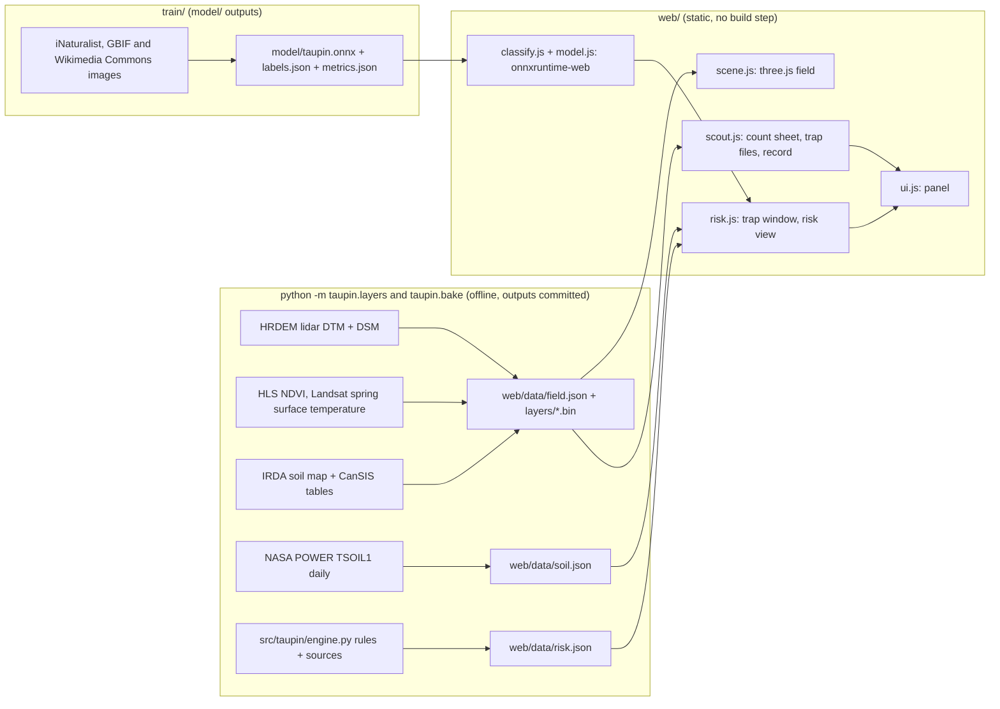

<p align="center"></p>

# Taupin

Taupin helps a Quebec grain farmer and their agronomist scout a field for wireworms before buying
insecticide-coated seed. It dates the bait-trap week from NASA POWER soil temperature, places the
traps on a 3D field built from lidar, NASA HLS, Landsat and the soil map, takes the counts, names a
soil insect from a photo, and compares pest levels for three crop rotations over five years. It
runs in the browser, offline; photos and counts never leave the device.

Built for NASA Space Apps 2026. Taupin is French for wireworm and click beetle.


## What it does

- **Why.** Since 1 August 2025 in Quebec, insecticide-coated seed (class 3A) needs an agronomist's
  prescription (Code de gestion des pesticides, D. 470-2025). The evidence for one field is a
  bait-trap count. In Labrie et al. 2020, 92.6 % of 68 corn fields stayed under 1 wireworm per trap.
- **When to trap.** Bait traps go in when the top 10 cm of soil holds 12 °C. From NASA POWER
  `TSOIL1`, 1995 to 2025: 14 May on average, 8 May in 2025.
- **Where to trap.** A 600 m square drawn from 1 m lidar relief and canopy, NASA HLS vegetation,
  Landsat spring surface temperature and the soil map. Ten trap points, about 25 m apart, are
  spread over four scouting zones of those layers. The zones are not a risk map.
- **Which fields first.** A model fitted on 82 Quebec bait-trapped fields ranks a field in the low,
  middle or high third for a year, from two field-form answers and two NASA POWER values. The
  output is a rank, not a probability.
- **Count.** A sheet for three lifts per trap. Each lift is compared on its own with the threshold
  of the dominant species (3 per trap for *Hypnoidus abbreviatus*, 1 for *Agriotes*, *Limonius*
  and *Melanotus*; RAP Grandes cultures, Agri-Réseau doc. 115269).
- **Identify.** Drop a photo; an 8-class model (DINOv2-S, ONNX, run with onnxruntime-web) names
  the animal and pins it on the field. Below its abstain threshold it answers "unclear" and shows
  how to send the photo to the MAPAQ plant diagnostic lab. Taupin sends nothing.
- **Plan.** Wireworm and corn rootworm levels for 2026 to 2030 under corn every year,
  corn-soybean-wheat, and a rotation with buckwheat. Each level lists its reasons with a source.
- **Hand over.** Trap points as GPX, CSV and GeoJSON, and a text record with the trap date, the
  counts, the ranking and the photos, for the agronomist. Taupin never decides the prescription.
  The agronomist signs.

## Prior work

VFF QC (CÉROM and MAPAQ, https://cerom.qc.ca/vffqc/) already gives a wireworm risk level per field,
from a model fitted on close to 800 Quebec fields. Taupin's model has 82 fields and is not a
stronger predictor. Taupin adds the trap week, NASA inputs, trap points inside the field, the count
sheet, the photo model and open code and data. `docs/PROJECT.md` has the comparison and the open
gaps.

## Run it

Needs Python 3.9 or newer (standard library only) and a browser. No install step, no network
after the first load. The `classify` and `bake` extras need Python 3.11 or newer.

| OS | Command |
|---|---|
| macOS | double-click `run.command`, or `./run.command` |
| Windows | double-click `run.bat` |
| Linux | `./run.sh` |
| Any, with uv | `uv run python -m taupin` |

The server listens on 127.0.0.1 from port 8780 (first free port) and opens the browser.
`--demo` opens the scripted 12 s sequence (`?demo=1`); `--port N` picks the port. The app also
installs as a PWA and keeps working offline once loaded.

Classify photos on the command line:

```bash
uv run --extra classify taupin classify photo1.jpg photo2.jpg
```

Taupin is a static web app served by Python's standard library. There is no Electron or Tauri
build: a browser tab does the same job with no download.

## How it is built



- `src/taupin/`: risk engine, POWER soil-temperature trap window, field layers, bake, local server,
  CLI classifier.
- `risk/`: the field risk model: digitized counts, NASA POWER features, fit and metrics.
- `web/`: the app. `three` 0.187.0, `onnxruntime-web` 1.31.1 and the fonts are vendored in
  `web/vendor/` (versions in `web/vendor/VERSIONS.md`).
- `train/`, `model/`, `data/`: classifier training, the exported model and its image attribution.
- `scripts/capture.mjs` drives headless Chrome for screenshots and demo frames;
  `scripts/make_gif.py` turns the frames into `docs/assets/demo.gif`.

Tests: `uv run pytest` (engine, soil, bake, classifier parity, server, web checks) and
`node --test web/test/*.test.mjs` (preprocessing, softmax, abstain, risk view, renderers). The
browser preprocessing matches the Python classifier on golden inputs.

## Model

From `model/metrics.json` (version `v2-dinov2s`, DINOv2-S fine-tuned, 8 classes, 23 MB as int8
ONNX). Below a top-1 probability of 0.892 after temperature scaling the app answers "unclear: send
to the lab". "Answered" is the share of photos above that threshold.

| Split | Photos | Accuracy | Macro-F1 | Answered | Accuracy when answered |
|---|---|---|---|---|---|
| Validation | 976 | 94.6 % | 0.946 | 90.0 % | 98.1 % |
| Test (sealed) | 756 | 92.5 % | 0.931 | 84.9 % | 97.5 % |
| Other sources (GBIF 334, Wikimedia Commons 157) | 491 | 92.7 % | 0.926 | 85.3 % | 97.4 % |

The previous version (`v1-effb0`) scores 86.1 % on the same test photos and 86.2 % on the same
other-source photos.

Limits, as measured:

- The other-source set was audited by eye by one person: 157 of 648 images were removed (adult
  beetles filed as larvae, plates, drawings, photos with no clear animal). Before the audit the
  model scored 76.5 % on all 648. The list is in `data/ood_audit.csv`.
- The model still answered 92 of those 157 removed images instead of sending them to the lab. A
  photo with no soil animal in it can get a confident name.
- The threshold is the 98 % validation target. It was chosen after the 95 % and 98 % targets had
  both been scored on test and other sources, so it was not fixed in advance.
- No test set of photos taken in Quebec fields exists yet.

Class counts, the threshold table and the split method are in `model/MODEL_CARD.md`.

## Data and licences

| Data | Use | Licence |
|---|---|---|
| NASA POWER daily point API (MERRA-2): `TSOIL1`, `GWETROOT` | trap date; two inputs of the field risk model | NASA open data |
| NASA HLS v2.0 (L30 and S30), 23 clear summer scenes, 2020 to 2025 | vegetation layer (NDVI) | NASA open data |
| USGS Landsat 8/9 Collection 2 Level-2, 46 clear April and May scenes, 2016 to 2025 | spring surface temperature layer | public domain |
| NRCan HRDEM lidar, 1 m, 2023 | relief, canopy height, slope, wetness index | Open Government Licence - Canada |
| IRDA soil map (1:20 000) and AAFC CanSIS tables | soil units and their texture | see `DATA_SOURCES.md` |
| OpenStreetMap, way 542903996 | park outline | ODbL |
| Labrie et al. 2020, PLoS ONE 15(2): e0229136 | bait-trap counts of the field risk model | CC BY 4.0 |
| iNaturalist, GBIF and Wikimedia Commons photos | classifier training and test | CC0, CC-BY or public domain, per image in `data/attribution.csv` |
| RAP Grandes cultures, Agri-Réseau doc. 115269 | bait-trap method and thresholds | cited |
| MAPAQ, Laboratoire d'expertise et de diagnostic en phytoprotection | route for unclear photos and species identification | cited |
| MAPAQ / RAP, Agri-Réseau doc. 118135 | corn rootworm rules | cited |
| Saguez et al. 2017, doi:10.1093/ee/nvx116; Noronha et al. 2023, doi:10.1007/s11829-023-09982-9 | wireworm factors | cited |
| Code de gestion des pesticides, D. 470-2025 | prescription rule | cited |

`DATA_SOURCES.md` lists every layer with its source, licence, native resolution and access date.

Model weights start from `timm/vit_small_patch14_dinov2.lvd142m` (Meta DINOv2, Apache-2.0).
Code: MIT (`LICENSE`). Fonts: Instrument Serif and Inter, OFL-1.1.

Gallery photos (Wikimedia Commons):

| Photo | Author | Licence |
|---|---|---|
| [Wireworm (Elateridae larva)](https://commons.wikimedia.org/wiki/File:Click_beetle_larvae.jpg) | ZATRIPPIT | CC0 |
| [Click beetle (Agriotes adult)](https://commons.wikimedia.org/wiki/File:Wireworm_Click_Beetle_-_Agriotes_obscurus_%3F_(51859491891).jpg) | gailhampshire | CC BY 2.0 |
| [Western corn rootworm adult](https://commons.wikimedia.org/wiki/File:Western_corn_rootworm.jpg) | unknown | Public domain |
| [Corn rootworm larvae](https://commons.wikimedia.org/wiki/File:Diabrotica_virgifera_virgifera_larvae.jpg) | Scott Bauer, USDA ARS | CC BY 3.0 |
| [Ground beetle (Carabidae)](https://commons.wikimedia.org/wiki/File:Pterostichus_melanarius_321269585.jpg) | Alexandria 'Alex' Wenninger | CC BY 4.0 |
| [White grub (scarab larva)](https://commons.wikimedia.org/wiki/File:Popillia_japonica_(28).jpg) | Michael Reding, USDA ARS, Bugwood.org | CC BY 3.0 US |

## Limits

- The demo field is a 600 m square in the Parc-nature du Bois-de-Liesse, Secteur des Champs
  (45.5013 N, 73.7651 W), a park in Montreal used as a stand-in for a farm field. Only 1.3 ha of it
  is open ground; the mapped meadows are about half regrown under the 2023 lidar. Nothing is dug,
  trapped or collected there.
- The field risk model has 82 fields and 11 at or above the threshold. Its four inputs were chosen
  after the first cross-validation, so its AUC of 0.80 (95 % CI 0.63 to 0.93) is optimistic; a
  whole year held out gives 0.68. It ranks fields; it does not give a probability.
- The scouting zones spread the traps over the field's variability. No source gives wireworm risk
  inside a field, so Taupin shows none.
- A photo is a first sort, not a count. A photo that shows no soil animal can still get a
  confident name: 92 of the 157 images removed from the outside test set were answered instead of
  "unclear" (`model/MODEL_CARD.md`).
- No farmer or agronomist has tried the tool yet.
- NASA POWER is a grid of about 50 km; a field can be a few days ahead of or behind the dates shown.
- Not a NASA product. Uses NASA open data.

## Citing

```bibtex
@software{taupin2026,
  title = {Taupin: bait-trap dates, trap points, counts, photo triage and rotation risk for a Quebec field},
  year  = {2026},
  note  = {NASA Space Apps Challenge 2026}
}
```

Cite the data sources above as well, in particular NASA POWER, NASA HLS and Labrie et al. 2020.

## AI assistance

Code, tests and documentation were written with AI coding assistants and reviewed by the team.
