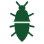
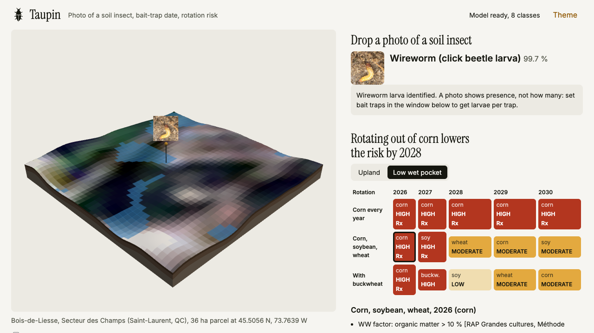
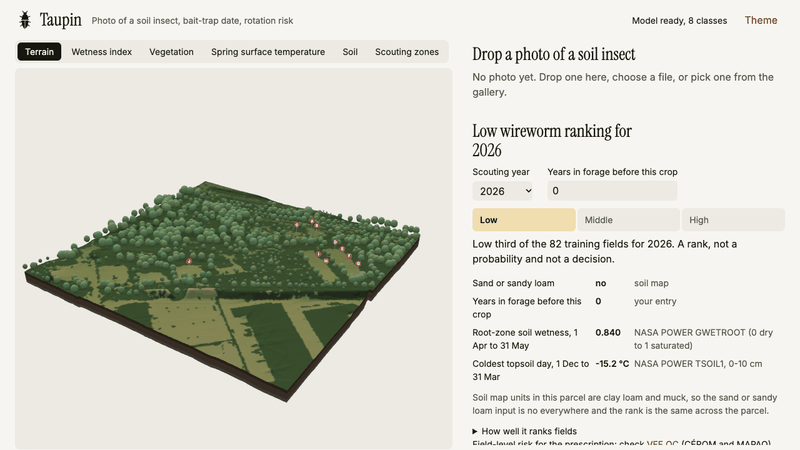
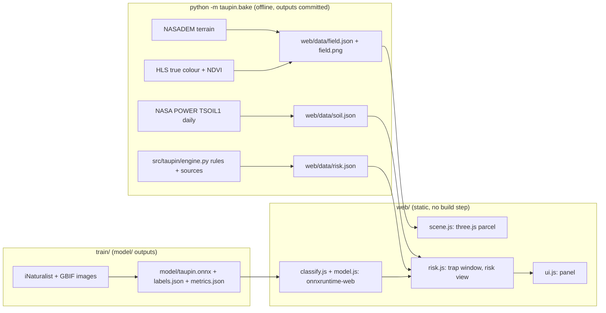

<p align="center"></p>

# Taupin

Taupin identifies a soil insect from a photo, dates the week to set wireworm bait traps from NASA
POWER soil temperature, and shows the wireworm and corn rootworm risk per year for three crop
rotations on a 36 ha parcel. It runs in the browser, offline; photos never leave the device.

Built for NASA Space Apps 2026. Taupin is French for wireworm and click beetle.





## What it does

- **Identify.** Drop a photo; an 8-class model (EfficientNet-B0, ONNX, run with onnxruntime-web)
  names the animal or answers "unclear: send to the lab" below its abstain threshold. The photo is
  pinned on the 3D parcel.
- **Trap date.** Bait traps go in when the top 10 cm of soil reaches 12 °C (larvae move up near
  8 °C). Mean date over 1995-2025: 14 May; in 2025: 8 May.
- **Rotation risk.** Wireworm and corn rootworm levels for 2026-2030 under corn every year,
  corn-soybean-wheat, and a rotation with buckwheat, in the upland and in the low wet pocket. Each
  level lists its reasons with a source. A confirmed wireworm photo shows which years would become
  HIGH, with an agronomist's prescription supportable, if bait traps reach the threshold; a photo
  never changes a level by itself.
- **Prescription rule.** Since 1 August 2025 in Quebec, insecticide-treated seed (class 3A) needs an
  agronomist's prescription (Code de gestion des pesticides, D. 470-2025). Taupin documents the
  case; the agronomist signs.

## Run it

Needs Python 3.9 or newer (standard library only) and a browser. No install step, no network
after the first load. The `classify` and `bake` extras need Python 3.11 or newer.

| OS | Command |
|---|---|
| macOS | double-click `run.command`, or `./run.command` |
| Windows | double-click `run.bat` |
| Linux | `./run.sh` |
| Any, with uv | `uv run python -m taupin` |

The server listens on 127.0.0.1 from port 8780 (first free port) and opens the browser.
`--demo` opens the scripted 12 s sequence (`?demo=1`); `--port N` picks the port. The app also
installs as a PWA and keeps working offline once loaded.

Classify photos on the command line:

```bash
uv run --extra classify taupin classify photo1.jpg photo2.jpg
```

Taupin is a static web app served by Python's standard library. There is no Electron or Tauri
build: a browser tab does the same job with no download.

## How it is built



- `src/taupin/`: risk engine, POWER soil-temperature trap window, bake, local server, CLI classifier.
- `web/`: the app. `three` 0.187.0, `onnxruntime-web` 1.31.1 and the fonts are vendored in
  `web/vendor/` (versions in `web/vendor/VERSIONS.md`).
- `train/`, `model/`, `data/`: classifier training, the exported model and its image attribution.
- `scripts/capture.mjs` drives headless Chrome for screenshots and demo frames;
  `scripts/make_gif.py` turns the frames into `docs/assets/demo.gif`.

Tests: `uv run pytest` (engine, soil, bake, classifier parity, server, web checks) and
`node --test web/test/*.test.mjs` (preprocessing, softmax, abstain, risk view, renderers). The
browser preprocessing matches the Python classifier on golden inputs.

## Model

From `model/metrics.json` (version `v1-effb0`, 8 classes, abstain below a top-1 probability of
0.738 after temperature scaling). "Answered" is the share of photos above the threshold.

| Split | Photos | Accuracy | Macro-F1 | Answered | Accuracy when answered |
|---|---|---|---|---|---|
| Validation | 976 | 90.5 % | 0.905 | 86.6 % | 95.0 % |
| Test (sealed) | 756 | 86.1 % | 0.872 | 81.1 % | 94.0 % |
| Out-of-distribution (GBIF, non-iNaturalist) | 488 | 74.6 % | 0.725 | 73.0 % | 86.2 % |

The threshold was chosen on validation; the test split was not used for any choice. Details,
class counts and the split method are in `model/MODEL_CARD.md`.

## Data and licences

| Data | Use | Licence |
|---|---|---|
| NASADEM (SRTM reprocessed), 30 m | parcel terrain, low wet pocket (lowest 15 % of cells) | NASA open data |
| HLS L30 T18TWR, 2025-08-12 | parcel colour and NDVI | NASA open data |
| NASA POWER daily TSOIL1, 1995-2025 | trap and larvae dates | NASA open data |
| iNaturalist and GBIF photos | classifier training and test | CC0, CC-BY or public domain, per image in `data/attribution.csv` |
| RAP Grandes cultures, Agri-Réseau doc. 115269 | wireworm scouting thresholds | cited |
| MAPAQ / RAP, Agri-Réseau doc. 118135 | corn rootworm rules | cited |
| Saguez et al. 2017, doi:10.1093/ee/nvx116; Noronha et al. 2023, doi:10.1007/s11829-023-09982-9 | wireworm factors | cited |
| Code de gestion des pesticides, D. 470-2025 | prescription rule | cited |

Model weights start from `timm/efficientnet_b0.ra_in1k` (Apache-2.0), pretrained on ImageNet-1k.
Code: MIT (`LICENSE`). Fonts: Instrument Serif and Inter, OFL-1.1.

Gallery photos (Wikimedia Commons):

| Photo | Author | Licence |
|---|---|---|
| [Wireworm (Elateridae larva)](https://commons.wikimedia.org/wiki/File:Click_beetle_larvae.jpg) | ZATRIPPIT | CC0 |
| [Click beetle (Agriotes adult)](https://commons.wikimedia.org/wiki/File:Wireworm_Click_Beetle_-_Agriotes_obscurus_%3F_(51859491891).jpg) | gailhampshire | CC BY 2.0 |
| [Western corn rootworm adult](https://commons.wikimedia.org/wiki/File:Western_corn_rootworm.jpg) | unknown | Public domain |
| [Corn rootworm larvae](https://commons.wikimedia.org/wiki/File:Diabrotica_virgifera_virgifera_larvae.jpg) | Scott Bauer, USDA ARS | CC BY 3.0 |
| [Ground beetle (Carabidae)](https://commons.wikimedia.org/wiki/File:Pterostichus_melanarius_321269585.jpg) | Alexandria 'Alex' Wenninger | CC BY 4.0 |
| [White grub (scarab larva)](https://commons.wikimedia.org/wiki/File:Popillia_japonica_(28).jpg) | Michael Reding, USDA ARS, Bugwood.org | CC BY 3.0 US |

## Limits

- The parcel is Bois-de-Liesse, Secteur des Champs (45.5056 N, 73.7639 W), a park in Montreal used
  as a stand-in for a farm field. No insects were collected there.
- A photo identification is triage, not a count. Levels change only with bait-trap counts, which
  the agronomist records. The model also errs: on the gallery it calls the ground beetle a click
  beetle.
- NASA POWER is a grid of about 50 km; a field can be a few days ahead of or behind the dates shown.
- Not a NASA product. Uses NASA open data.

## Citing

```bibtex
@software{taupin2026,
  title = {Taupin: soil-insect photo triage, bait-trap dates and rotation risk for a Quebec parcel},
  year  = {2026},
  note  = {NASA Space Apps Challenge 2026}
}
```

Cite the data sources above as well, in particular NASA POWER, NASADEM and HLS.

## AI assistance

Code, tests and documentation were written with AI coding assistants and reviewed by the team.
